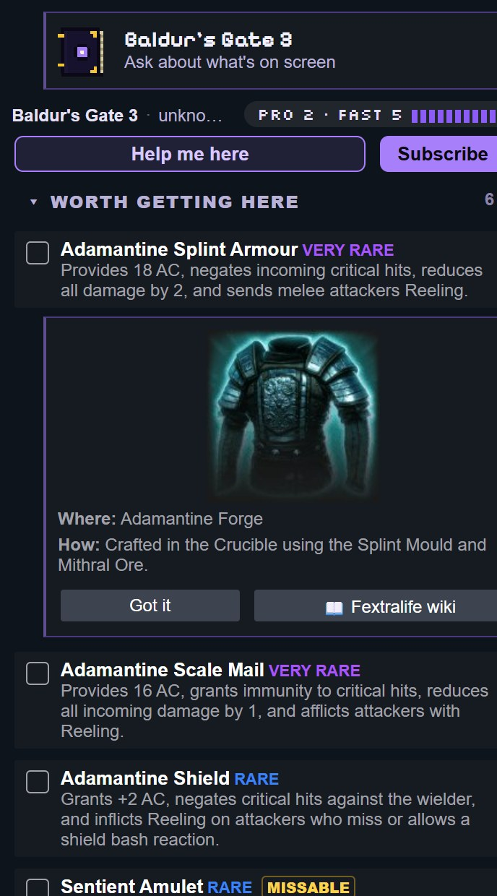
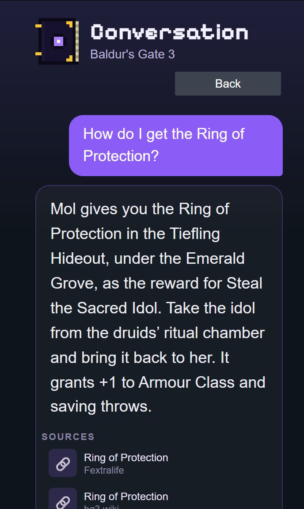

# Quest Compendium for Steam Deck

An AI game companion in your Quick Access menu. Stuck? Tap a question like **"What should I do next?"**, hold to talk,
or type your own, and Quest Compendium looks at your game and answers, without leaving the game. For any game.

This is the Steam Deck companion to [Quest Compendium](https://github.com/TuriusX/Quest-Compendium) for Windows
([questcompendium.com](https://questcompendium.com)). It is a [Decky Loader](https://decky.xyz) plugin.

<p>
  
  
</p>

## Features

- **Sees your game.** Sends one screenshot of the game layer (using gamescope's default screenshot mode), so answers
  match what's on screen. You can turn this off.
- **Help me here.** One press looks at your screen (the map, your journal, place names), works out where you are and
  what you're doing, and shows a video or picture for it. It has its own daily allowance, so it doesn't use up your
  questions.
- **Worth getting here.** For the area you're in, the gear, spells, quests and people worth your time, best first, with
  rarity in loot colours and a warning on anything you can miss. Press an item for its card: a picture, where and how
  to get it, and its wiki page. Works for any game; only things trusted sources back are listed.
- **Achievements here.** The area's Steam achievements, with the ones you're about to lose first.
- **Pictures and videos.** When it helps, an answer comes with a wiki picture of the thing, or a video that starts at
  the right moment.
- **Sources.** Under an answer, the wiki and guide pages it came from, opening in Steam's browser over the game.
- **Marked screenshots.** Answers about your screen show the screenshot with the spots the AI points at, numbered.
- **Fast or Pro, and three styles.** Fast for quick answers, Pro for harder ones. Standard, Min-Max (efficiency and
  completion) or Roleplay (in-universe, spoiler-friendly hints).
- **Controller-friendly.** Preset questions, hold to talk, the on-screen keyboard for your own, and full answers you can
  read by pressing down in the Quick Access panel. A full-screen view shows the whole conversation.
- **Guides tab.** One-tap guide sites (GameFAQs, Neoseeker, Fandom, IGN, Reddit, YouTube, or your own) open in a guide
  browser that stays open while you play: jump back into the game, then **Resume guide** right where you left off.
- **Works right away.** Try it as a guest with no sign-in. To use Premium, link your Quest Compendium account by
  scanning a QR code with your phone (the **Subscribe** button shows one for the Premium plans).
- **Per-game conversations.** Follow-up questions keep context; a new game starts a fresh conversation.

## Free and Premium

| | Questions a day |
|---|---|
| Guest (no sign-in) | 1 Pro + 3 Fast |
| Free (linked account) | 2 Pro + 5 Fast |
| Premium, $4.99 a month or $39.99 a year | 8 Pro + 25 Fast, unused ones carry over (up to 100) |

Your Premium plan is shared with the Windows app.

## Requirements

- Steam Deck (or another SteamOS device) in Gaming Mode
- [Decky Loader](https://github.com/SteamDeckHomebrew/decky-loader)
- An internet connection
- Screenshots use `gamescopectl`. Use **Options, then Test screenshot** to check it works on your device.

## Install

This plugin is **not in the Decky Plugin Store**, so install it manually. Decky recommends caution with manual installs;
the full source is in this repository.

1. In Gaming Mode, open the Quick Access menu, then Decky (plug icon), then the settings cog.
2. Turn on **Developer Mode**. A **Developer** tab appears.
3. Open **Developer**, choose **Install Plugin from URL**, and enter:
   ```
   https://github.com/TuriusX/Quest-Compendium-Decky/releases/latest/download/quest-compendium-decky.zip
   ```
4. Confirm. **Quest Compendium** (book icon) appears in the Decky list.

Alternatively, download `quest-compendium-decky.zip` from the [Releases](../../releases) page and use
**Install Plugin from ZIP**.

**Updating:** manually installed plugins don't update automatically. Repeat the install with the same URL to get the newest release.

## Using it

1. Start a game, open the Quick Access menu, and open Quest Compendium.
2. Tap **Help me here** to find where you are, or tap a preset question, hold to talk or type your own, then **Ask**.
   The Pro model is smarter but slower (it can take up to a minute).
3. Tap **Read full answer** for a full-screen view you can scroll with the D-pad, with the answer's picture or video
   and its sources.
4. Once Help me here or an answer knows where you are, **Worth getting here** fills in under it. The first time anyone
   asks about an area it says "Finding what's worth getting here…" for a moment.

### Linking your account

In **Account**, tap **Link account**. Scan the QR code with your phone, sign in with Google, and confirm the code shown on
your Deck. The panel then shows your account, and your Premium status if you have it. Without linking you're a guest with
a small daily allowance.

## Privacy: what gets sent

No screenshot or question leaves your Deck until you tap Ask or Help me here.

- **When you ask:** your question, the name of the running game, up to your last 10 conversation turns, and (if
  "Include screenshot" is on) one screenshot are sent to the Quest Compendium server, which forwards them to
  Google's Gemini API to produce the answer. The answer's picture or video is then looked up from the question and
  answer text.
- **When you tap Help me here:** one screenshot and the name of the running game, to work out where you are.
- **When you open the panel:** a request checks your remaining daily questions (your guest ID or linked account only).
  If Help me here or an answer has found where you are, the game's name and that place's name are sent to look up
  what's worth getting there (no screenshot, no question).
- **Stored on your Deck:** your settings, a random guest ID, and (if linked) sign-in tokens, in Decky's settings folder for
  this plugin, readable only by your user. Unlink from the Account section to remove the tokens.
- **Not in the plugin:** no analytics or tracking.

The server's own data handling is described in the [Quest Compendium privacy policy](https://quest-compendium-890629309063.us-east1.run.app/privacy).

## Troubleshooting

- **"Couldn't verify the server's security certificate":** update to 0.1.1 or newer, then check the log (below).
- **Test screenshot fails:** include the exact message when opening an issue. It means gamescope's screenshot tool isn't available or didn't respond.
- **Logs:** look under `~/homebrew/logs`. Tokens and question text are never logged:
  ```
  grep -rh "Network error\|CA bundle" ~/homebrew/logs | tail
  ```
- **Backend not responding:** in Konsole, run `sudo systemctl restart plugin_loader`.

## Development

Requires Node 22+, pnpm, and Python 3.

```bash
pnpm install
pnpm run typecheck
pnpm run build       # builds dist/index.js
pnpm run package     # also builds out/quest-compendium-decky.zip
```

Deploy to a Deck by copying the built folder into `~/homebrew/plugins/` and restarting `plugin_loader`. The included
`.vscode` tasks (from the Decky plugin template) automate build and SSH deploy.

**Tests** (`tests/`) run the real Python backend against a live local server with simulated Firebase/Google,
a fake `gamescopectl`, and a local HTTPS server. They need Python 3, `aiohttp`, `ffmpeg`, `openssl`, and Node:

```bash
cd tests && npm install && npm test
```

**Releasing:** bump `version` in `package.json` and add a `## <version>` section to `CHANGELOG.md` (the release notes),
commit, then tag and push, for example `git tag v0.1.3 && git push origin main v0.1.3`. The Release workflow checks the
tag matches `package.json`, typechecks, builds the zip and publishes the release with that changelog section as its
notes. That's the only step: don't create the release by hand (if one exists, the workflow replaces its zip and notes).
To check a tag without publishing, run the Release workflow from the Actions tab (a dry run).

### Architecture

A thin client. The React frontend (Quick Access panel and answer page) calls a Python backend (`main.py`) that captures the
screenshot, talks to the Quest Compendium server over HTTPS, and stores sign-in state. All AI calls, quotas, and Premium checks
happen on the server.

## AI disclosure

Most of this plugin's code was written with the help of an AI assistant (Claude, by Anthropic), directed and tested by the
maintainer on a real Steam Deck. The Quest Compendium server and app were built with Google AI Studio (Gemini). The
plugin's function is to answer game questions with a Gemini model.

## License

BSD-3-Clause. Built from the [Decky plugin template](https://github.com/SteamDeckHomebrew/decky-plugin-template);
the original template license is retained in [LICENSE](LICENSE). Not affiliated with Valve or the Decky team.
